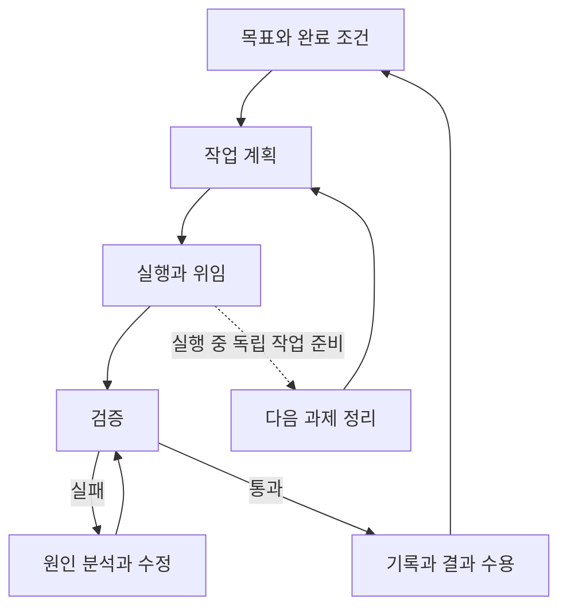

# OpenCode 팀 활용 가이드

부제: **AI에게 질문하는 단계에서, 일을 맡기고 검증하는 단계로**

이 문서는 웹페이지에 실을 완성 원고다. ‘발표 요약’은 발표 모드, 나머지는 읽기 모드에 사용한다. 코드 블록은 교육용 예제이며 실제 실행 여부는 사내 설치판과 환경에 따라 달라진다. 출처 번호는 SOURCES.md에 연결한다.

기존 자료 확인일: 2026-10-01. 스킬 추천·검증 운영 안내 추가: 2026-10-13. 사내 설치 버전: 입력 필요. 사내 모델·인증·할당량: 담당자 안내 필요.

---

## 01. 왜 사내 OpenCode를 사용하는가 {#why}

### 발표 요약

- 사내 업무 데이터는 승인된 사내 서비스와 모델에서 처리한다.
- 개인 토큰 잔량보다 작업 품질과 완료 조건에 집중한다.
- 혼잡 시간에는 사내 검증 도구로 테스트하고 다음 작업의 개선 사항을 정리한다.

### 본문

사내 OpenCode를 활용하면 프로젝트의 코드와 문서를 살펴보고, 구현과 테스트까지 한 흐름으로 진행할 수 있습니다. 익숙한 개발 환경에서 AI에게 작업을 맡기고 결과를 직접 확인하는 것이 장점입니다. 업무에 사용할 모델과 플러그인, MCP는 사내에서 제공하는 구성을 사용하고, 연결과 로그 저장 설정은 사내 안내를 따릅니다. [S01, S02]

사내 AI를 활용하면 개인 토큰 잔량에 대한 부담을 줄이고 작업의 품질과 완성도에 집중할 수 있습니다. 필요한 분석과 검증을 충분히 진행하되, 사내 서비스의 사용 한도와 혼잡 상황을 고려해 작업을 나눕니다.

### 사내 활용 경험

| 시간 | 발표자가 관찰한 상태 | 작업 방식 제안 |
|---|---|---|
| 14:00~22:00 | 응답 지연·중단이 발생하는 혼잡 구간 | 작업을 작게 나누고 중간 기록을 남긴다 |
| 특히 15:00~17:00 | 불안정이 두드러짐 | 프롬프트·계획·검증 조건을 먼저 정리한다 |
| 상대적으로 여유로운 시간 | 상황에 따라 실행하기 편함 | 준비된 작업을 실행하고 결과를 검토한다 |

위 시간대는 **발표자의 사내 활용 경험**을 바탕으로 정리했습니다. 실제 응답 속도는 사용량과 서비스 상태에 따라 달라질 수 있습니다. 응답이 지연되면 요청을 반복하기보다 진행 상황을 기록하고, 테스트나 다음 작업 준비에 시간을 활용합니다.

### 사내 사용 시 먼저 확인할 것

승인된 모델 연결인지, 외부 제공자로 자동 전환되는 설정은 없는지, 플러그인과 MCP가 허용되는지 확인합니다. 사내 세션의 공개 공유는 사용하지 않습니다. 공유 비활성화 설정은 설치판의 스키마를 확인한 후 적용합니다. [S01, S02]

```json
{
  "$schema": "https://opencode.ai/config.json",
  "share": "disabled"
}
```

이 설정은 세션의 공개 공유를 끄는 용도입니다. 모델과 도구의 연결 설정은 사내 안내에 맞춰 별도로 확인합니다.

---

## 02. OpenCode는 무엇인가 {#basics}

### 발표 요약

- OpenCode는 모델을 연결해 개발 작업을 수행하는 AI 코딩 에이전트다.
- 채팅뿐 아니라 파일 읽기·수정·명령 실행·작업 위임이 가능하다.
- 먼저 파일 지정, 계획/구현 전환, 세션 관리를 익힌다.

### 본문

OpenCode는 프로젝트 안에서 AI 모델과 도구를 함께 사용하는 개발 환경입니다. 모델이 답을 생성하고, OpenCode가 파일·터미널·권한·세션을 연결합니다. 모델은 두뇌, OpenCode는 작업 공간으로 생각하면 이해하기 쉽습니다. 이 가이드에서는 터미널 화면(TUI)을 중심으로 설명합니다. 사용할 수 있는 화면과 기능은 사내 설치 버전에 따라 다릅니다. [S03, S04]

Oh My OpenCode는 기본 OpenCode와 별개의 확장입니다. 스킬은 반복 가능한 작업 절차이고, MCP는 외부 도구나 데이터와 연결하는 인터페이스입니다. 각각 확장 기능, 작업 절차, 도구 연결이라는 역할을 맡습니다.

### 먼저 익힐 명령과 단축키

아래 목록은 참고자료 확인일의 OpenCode TUI 문서를 기준으로 정리했습니다. 단축키는 사용자 설정으로 바뀔 수 있습니다. `Ctrl+X → N`은 동시에 누르는 조합이 아니라 Ctrl+X를 누른 다음 N을 누른다는 뜻입니다. [S03, S05]

| 입력 | 기능 | 기본 단축키 / 설명 |
|---|---|---|
| `opencode` | 현재 프로젝트에서 시작 | 터미널에서 입력 |
| `/help` | 도움말 | 사용 가능한 기능 확인 |
| `@파일경로` | 파일을 대화 맥락에 추가 | 필요한 파일만 지정 |
| `!명령어` | 셸 명령 실행 | 결과가 대화에 들어감 |
| `Tab` | 기본 에이전트 전환 | Build / Plan 등 설치판의 역할 |
| `/models` | 모델 선택 | Ctrl+X → M |
| `/init` | AGENTS.md 생성·갱신 도움 | 생성 결과를 검토 |
| `/new` | 새 세션 시작 | Ctrl+X → N |
| `/sessions` | 이전 세션 조회·전환 | Ctrl+X → L |
| `/compact` | 긴 대화 요약 | Ctrl+X → C |
| `/undo` | 마지막 메시지와 관련 변경 되돌리기 | Ctrl+X → U, Git 필요 |
| `/redo` | 되돌린 작업 재적용 | Ctrl+X → R |
| `/editor` | 긴 지시문을 외부 편집기로 작성 | Ctrl+X → E |
| `Ctrl+P` | 명령 목록 | 명령을 기억하지 못할 때 사용 |

`/compact`는 대화 정리 기능입니다. 프로젝트 규칙과 진행 기록을 별도 파일로 남기는 일을 대신하지 않습니다.

### 반복 지시는 사용자 명령으로

예를 들어 ‘변경 내용을 읽고 리뷰하라’는 지시를 사용자 명령으로 저장하면 반복 입력을 줄일 수 있습니다. 프로젝트 명령은 `.opencode/commands/` 아래 Markdown 파일로 정의할 수 있습니다. 실제 문법은 설치판 문서를 따릅니다. [S06]

교육용 `review-change.md` 내용:

```markdown
---
description: 변경 사항 검토
---
현재 변경 내용을 읽고 오류 가능성, 회귀 위험, 필요한 검증을 정리하라.
파일은 수정하지 말고, 발견 사항마다 근거와 위치를 제공하라.
```

### 첫 작업 예시

```text
이 프로젝트의 실행 방법과 테스트 방법을 확인해줘.
수정하지 말고 핵심 디렉터리, 진입점, 사내 규칙을 정리해줘.
확인하지 못한 것은 추측하지 말고 미확인이라고 표시해줘.
```

---

## 03. 결과를 바꾸는 스킬·하네스·메모리 {#harness}

### 발표 요약

- 같은 모델도 주어진 절차와 검증 환경에 따라 결과가 달라진다.
- Ponytail·Caveman·Superpowers는 용도에 맞춰 검토하고, 항상 사내에서 제공하는 버전을 사용한다.
- 스킬은 작업 절차, 하네스는 실행·검증·재개를 관리하며, 반복 실수는 기록과 회귀 검증으로 줄인다.

### 본문

OpenCode의 결과는 모델 능력만으로 결정되지 않습니다. 요구사항, 필요한 맥락, 도구, 스킬, 검증 방식이 함께 작동해야 합니다. ‘좋은 모델이면 알아서 한다’보다 **좋은 작업 환경을 만들어 준다**는 관점이 유용합니다.

| 요소 | 역할 | 교육용 예 |
|---|---|---|
| 모델 | 문제를 해석하고 판단 | 구현 방안 제안 |
| 스킬 | 특정 업무에 반복해서 쓰는 절차 | Babylon.js 변경 시 picking·색상·성능 점검 |
| 하네스 | 실행·권한·검증·재개를 연결 | 테스트 실행, 실패 시 수정, 결과 기록 |
| 메모리 | 다음 작업에 필요한 규칙과 경험 보존 | thin instance 식별 오류와 해결 조건 기록 |

OpenCode 스킬은 `SKILL.md`로 정의하고 필요할 때 로드하는 방식입니다. 장기 작업 하네스에 대한 참고자료로는 Anthropic의 운영 사례가 있습니다. 이 자료는 진행 기록과 실제 사용자 흐름 검증을 장기 작업에 연결하는 접근을 소개합니다. [S07, S09]

### 개발에 추천하는 스킬과 하네스 — 사내 제공 버전 기준

아래는 개발할 때 도움이 될 만한 스킬과 하네스의 활용 예입니다. **업무에는 항상 사내에서 제공하는 도구를 사용하세요.** 공개 프로젝트 링크는 용도를 살펴보기 위한 참고자료입니다. 사내 제공 여부는 담당자에게 확인하고, 필요한 도구가 없다면 도입 검토를 요청합니다.

| 필요할 때 | 추천 후보 | 어떻게 활용할까 | 지켜야 할 기준 |
|---|---|---|---|
| 매번 같은 개발 규칙을 설명할 때 | 사내 공통 SKILL.md + AGENTS.md | 프로젝트 구조, 테스트 명령, 리뷰 기준과 반복 오류를 연결하는 기본 구성 | 팀 규칙과 실제 코드에 맞게 유지 [S07, S08] |
| 과한 추상화·불필요한 의존성이 늘어날 때 | Ponytail | 기존 코드와 플랫폼 기능을 먼저 살펴보고 요구사항을 만족하는 작은 변경을 선택 | 검증·오류 처리·접근성까지 줄이지 않기 [S15] |
| 중간 보고와 답변이 지나치게 길 때 | Caveman | 기술적 사실은 유지하면서 반복 설명과 군더더기를 줄이기 | 조건·부정문·숫자·명령어 보존, 중요한 안내는 충분히 설명 [S16] |
| 테스트와 디버깅 절차를 일정하게 만들 때 | Superpowers의 테스트·디버깅·완료 전 검증 스킬 | 테스트 주도 개발, 원인 조사, 완료 증거 확인 등 필요한 절차를 골라 적용 | 작은 수정에 전체 절차를 과하게 적용하지 않고 사내 규칙과 충돌 여부 확인 [S17] |
| 여러 작업의 계획·위임·재개를 관리할 때 | 사내 제공 OpenCode + OmO 하네스 구성 | 작업 범위와 검증 조건을 나누고 진행 기록을 남기기 | 사내 설치판의 명령·권한·모델 연결을 먼저 확인 [S04, S13] |

Ponytail은 구현을 단순하게 만드는 데, Caveman은 응답을 간결하게 만드는 데 초점을 둡니다. 작업지시서를 요약하는 일은 별도로 요청하는 편이 좋습니다. 지시문을 다듬거나 줄일 때는 05장의 사내 AI 템플릿을 사용하고, 완료 조건이 빠지지 않았는지 확인합니다. 효과는 우리 팀의 실제 과제로 비교해 확인합니다.

스킬과 도구를 사용할 때는 업무 맥락, 코드, 로그 등이 연결된 서비스로 전달될 수 있습니다. **사내 제공 구성을 사용하고, 어떤 정보가 어디로 전달되는지 확인하세요.** 연결 대상과 전송 범위가 불분명하면 담당자의 안내를 받습니다.

처음에는 사내 공통 규칙과 검증 절차를 갖추고, 필요한 경우 구현 단순화나 응답 간결화 스킬을 하나씩 더하는 구성을 추천합니다. 여러 스킬을 동시에 켜기보다 작은 과제로 결과와 재작업을 비교하세요.

### 같은 과제를 다르게 맡기는 예제

과제: Babylon.js 장비 1,000개의 상태 색상과 클릭 정보창 구현.

**A — 결과만 요구**

```text
장비 1,000개를 만들고 상태에 따라 색상을 바꿔줘.
클릭하면 장비 정보가 뜨게 해줘.
```

**B — 절차·검증·기록까지 요구**

```text
장비 1,000개의 상태 색상과 클릭 정보창을 구현한다.
먼저 기존 장면 구조와 관련 팀 스킬을 읽고 구현 계획을 작성한다.
반복 장비의 형상과 재질 조건을 확인한 뒤 thin instance 적용 여부를 판단한다.
객체 식별과 picking 매핑을 점검하고, 색상 적용 방식은 현재 셰이더 구조에 맞춘다.

완료 조건:
- 정상/경고/오류 상태가 구분된다.
- 클릭한 장비의 ID와 정보창의 ID가 일치한다.
- 상태 갱신 후 색상이 반영된다.
- 기존 카메라 조작이 유지된다.

검증:
- ID 매핑과 상태 변환은 단위 테스트로 확인한다.
- Playwright로 클릭과 정보창을 확인하고 화면을 캡처한다.
- 성능은 지정된 기기와 장면 조건에서 측정하고 실제 값을 보고한다.
- 이번 오류와 재발 방지 방법을 진행 기록에 남긴다.
```

두 예제는 작업 지시를 어떻게 구체화할 수 있는지 보여줍니다. 실습에서는 같은 모델과 초기 코드를 사용하고, 누락된 기능·테스트 결과·재작업 횟수·소요 시간을 비교해 보세요.

### 같은 실수를 줄이는 기록 방법

```text
AGENTS.md                  팀 공통 규칙과 시작 시 읽을 문서
docs/ai/known-pitfalls.md   검증된 반복 오류와 회피 방법
docs/ai/decisions.md        설계 결정과 이유
docs/ai/progress.md         현재 상태, 미완료, 다음 행동
tests/                     재발 여부를 확인할 검증
```

`docs/ai/*`는 **이 자료에서 제안한 팀 규약**입니다. 다음 작업에서도 참고할 수 있도록 AGENTS.md나 작업 지시에 읽어야 할 기록을 명시합니다. OpenCode는 프로젝트 규칙을 AGENTS.md로 제공할 수 있습니다. [S08]

좋은 오류 기록에는 ‘증상 → 원인 → 적용 조건 → 해결 → 재발 검증’이 들어갑니다. 임시 추측과 비밀번호를 영구 규칙에 넣지 않고, 오래된 내용을 정리합니다.

### 이것이 루프 엔지니어링인가?

메모리 파일 작성 자체는 주로 맥락·메모리 관리입니다. **실행 → 검증 → 오류 기록 → 절차 수정 → 재실행**까지 연결하면 반복 개선 루프를 설계하는 것으로 설명할 수 있습니다. ‘루프 엔지니어링’은 여기서 교육적 표현이며 OpenCode의 표준 기능명은 아닙니다.

반복에는 종료 조건도 필요합니다. 예를 들어 같은 오류가 두 차례 반복되면 사람에게 원인과 로그를 넘기고, 검증 도구를 실행할 수 없으면 완료로 표시하지 않습니다.

---

## 04. Oh My OpenCode와 ultrawork {#omo}

### 발표 요약

- 확장은 탐색·분해·위임·검증 흐름을 구성하는 데 도움을 준다.
- ultrawork는 작업 방식이며, 별도의 초고성능 모델을 만드는 기능은 아니다.
- 간단한 수정은 직접, 복잡한 작업은 구조화해서 맡긴다.

### 본문

Oh My OpenCode는 OpenCode에 계획·위임·검증 흐름을 더하는 확장 프로젝트입니다. 원본 저장소는 확인 시점 Oh My OpenAgent로 연결됩니다. 사내에서 계속 Oh My OpenCode라는 이름을 사용하더라도 설치된 버전의 명령과 문서를 기준으로 해야 합니다. [S12]

`ultrawork` 또는 `ulw`는 작업을 적극적으로 탐색·분해·위임·검증하도록 유도하는 방식입니다. ‘Ultra Worker를 만든다’는 표현은 이런 작업 흐름을 구성한다는 의미로 설명합니다. `Ultraworker`라는 고정 에이전트가 모든 버전에 존재하는 것은 아닙니다. [S13]

### 기대하는 이점과 적용 판단

- 관련 코드를 찾고 작업을 나누는 부담을 줄일 수 있습니다.
- 독립 작업을 위임하고 각 작업에 필요한 스킬을 연결할 수 있습니다.
- 완료 조건과 증거를 중심으로 결과를 검토하는 흐름을 만들 수 있습니다.

| 상황 | 제안 |
|---|---|
| 오타 수정·단일 설정 변경 | 기본 에이전트로 직접 처리 |
| 여러 파일에 걸친 기능 구현 | 계획을 문서화한 후 실행 |
| 작업 분해와 탐색이 많이 필요 | 설치판의 ultrawork 흐름 검토 |
| 같은 파일을 여러 작업이 수정 | 병렬화보다 책임 분리·통합 순서 우선 |
| 사내 서비스 혼잡 | 동시 실행 수를 줄이고 작업 준비 |

작업 규모에 맞춰 활용 방식을 선택하세요. 여러 에이전트에게 나누어 맡길 때는 맥락을 전달하고 결과를 합치는 시간도 고려해야 합니다.

교육용 지시:

```text
ulw
이 작업의 목표는 사용자 목록 필터 기능 구현이다.
기존 구조를 확인하고 범위를 나눈 뒤 적절한 스킬과 검증 방법을 적용해줘.
완료 조건과 실제 검증 결과를 보고해줘.
사내에서 승인된 모델과 도구만 사용해줘.
```

---

## 05. 프롬프트를 먼저 설계한다 {#prompts}

### 발표 요약

- 프롬프트를 다듬거나 작업지시서를 짧게 만들 때는 사내 AI를 활용한다.
- 목표·범위·제약·완료 조건·검증 방법을 빠뜨리지 않는다.
- 짧게 줄여도 제약과 검증 기준은 유지하고, 업무 자료는 항상 사내 제공 AI에서 처리한다.

### 본문

머릿속 아이디어를 바로 긴 작업으로 맡기면 실행 중에 조건이 계속 달라질 수 있습니다. **프롬프트의 표현을 다듬거나 긴 작업지시서를 짧게 정리할 때는 사내에서 제공하는 AI를 활용하는 것이 좋습니다.** 요구사항 정리에 사내 AI를 활용한 뒤 OpenCode에 전달하면 목표와 판단 기준을 더 명확하게 만들 수 있습니다. 정리한 지시문은 직접 읽어보고 의도와 빠진 조건이 없는지 확인합니다.

짧은 문장에도 사내 시스템명, 코드 경로, 오류 로그, 고객 정보가 포함될 수 있습니다. 단순 문장 다듬기라도 데이터 전송이 발생할 수 있으므로 업무 지시와 자료는 항상 사내에서 제공하는 AI에서 처리합니다. 축약한 지시문은 원문과 비교해 범위, 제외 사항, 제약, 완료 조건, 검증 방법이 보존됐는지 확인합니다.

### 1단계 — 사내 AI에게 업무 지시를 정리시키기

```text
다음 요구를 코딩 에이전트에 전달할 작업 지시로 정리해줘.
목표, 범위, 제외 범위, 제약, 완료 조건, 검증 방법, 산출물 순서로 작성해줘.
확인되지 않은 환경은 만들어내지 말고 확인 필요로 표시해줘.
구현 방법을 과하게 고정하지 말고, 기존 프로젝트 구조를 먼저 확인하도록 해줘.

요구: 장비 목록에 상태 필터를 추가하고, 선택한 장비를 3D 화면에서 강조하고 싶다.
```

### 긴 작업지시서를 짧게 만드는 템플릿

사내 AI에서 사용하는 교육용 지시입니다. 실제로 사용할 수 있는 모델과 입력 범위는 사내 안내를 따릅니다.

```text
아래 작업지시서를 코딩 에이전트에 전달하기 쉽게 짧게 정리해줘.
중복 설명은 줄이되 목표, 범위, 제외 범위, 제약, 완료 조건, 검증 방법은 유지해줘.
부정 조건, 수치, 파일 경로, API 이름을 임의로 바꾸지 말아줘.
조건을 빠뜨려야만 길이를 맞출 수 있다면 길이보다 의미 보존을 우선해줘.
확인할 사항은 별도로 표시하고, 새 요구사항은 추가하지 말아줘.
마지막에 원문 대비 빠지거나 달라진 조건이 있는지 점검해줘.

원문: [사내에서 허용된 작업지시서]
```

### 2단계 — 실행할 프롬프트

```text
목표: 장비 목록에서 상태를 필터링하고 선택한 장비를 3D 화면에서 강조한다.
범위: 목록 필터, 선택 이벤트, 장면의 강조 처리.
제외: 인증 변경, 전체 UI 개편, 관련 없는 리팩터링.
제약: 기존 구조와 팀 규칙을 따른다. 승인된 도구만 사용한다.
완료 조건: 필터와 표시 목록이 일치하고 선택 ID와 강조 장비 ID가 일치한다.
검증: 필터 단위 테스트와 실제 선택 흐름의 브라우저 테스트.
산출물: 변경 요약, 실제 검증 결과, 남은 문제, 재개 기록.

먼저 관련 코드를 확인하고 계획을 제시해줘. 계획 확인 후 구현한다.
```

좋은 프롬프트에는 무엇을 해야 하고 어떤 상태를 완료로 볼지 분명하게 드러납니다. 필요한 맥락을 유지하면서 중복 문장을 줄입니다.

---

## 06. 계획·실행 역할과 세션 관리 {#sessions}

### 발표 요약

- Planner는 무엇을 할지, Executor는 계획을 어떻게 진행할지 담당한다.
- 계획 파일과 대화 세션은 서로 다른 기록이다.
- 끊겼을 때는 현재 코드와 검증 기록을 확인한 뒤 재개한다.

### 역할 이해

| 역할 | 하는 일 | 주요 산출물 |
|---|---|---|
| Planner | 요구 분석, 범위·의존성·완료 조건 정리 | 작업 계획 |
| Plan Executor / Orchestrator | 계획 순서 관리, 위임, 결과 통합 | 진행 상태와 통합 결과 |
| Worker | 특정 구현·탐색·테스트 수행 | 변경 내용과 근거 |
| Reviewer / QA | 결과와 완료 조건을 독립적으로 확인 | 발견 사항과 검증 증거 |
| 사람 | 우선순위·제약·수용 여부 판단 | 승인된 목표와 다음 작업 |

이 표는 작업을 나누는 기준입니다. 하나의 에이전트가 여러 역할을 맡을 수도 있습니다. OpenCode의 기본 Plan·Build와 확장 플러그인이 제공하는 역할은 구분해서 확인하세요. [S04]

### 설치 버전에 따른 차이

| 구분 | 기존 OmO 자료에서 알려진 방식 | 현재 원본 dev 문서에서 확인한 방식 |
|---|---|---|
| 계획·실행 | Prometheus / Atlas | 메인 에이전트의 계획·실행 흐름 |
| 명령 예 | 계획 후 `/start-work` | `/ulw-plan` 후 `/ulw-execute` |
| 계획 경로 | `.sisyphus/plans/*.md` | `.omo/plans/*.md` |
| 진행 상태 경로 | `.sisyphus/boulder.json` | `.omo/boulder.json` |

왼쪽은 이전 방식, 오른쪽은 참고자료 확인일의 개발 브랜치(dev) 문서를 정리한 것입니다. 사내 버전에 따라 이름·명령·저장 경로가 다를 수 있으므로 실습에는 설치된 버전의 안내를 사용하세요. [S13, S14]

### 계획은 무엇을 저장하는가

계획 파일에는 작업 항목, 참조 파일, 완료 조건, 검증 방법을 남깁니다. 진행 상태는 어떤 계획을 실행 중인지 연결하고, 대화 세션은 요청과 응답을 보존합니다. **계획 파일만으로 이전 대화의 모든 맥락이 복원되지는 않습니다.**

계획을 다음 세션에서도 쓰려면 저장할 파일 경로를 작업 지시에 명시하세요. 플러그인을 쓰지 않는 팀은 계획을 `docs/ai/plans/<작업명>.md`에 저장하도록 명시할 수 있습니다. 이 경로는 팀 제안이며 OpenCode 기본 저장 경로가 아닙니다.

### 재개할 때의 순서

1. `/sessions`에서 해당 대화를 찾거나 작업 계획을 명시해 새 세션을 시작합니다.
2. 해당 설치판의 계획·진행 기록과 실제 변경 내용을 읽습니다.
3. 마지막 테스트 결과를 확인하고 필요한 검증을 다시 실행합니다.
4. 완료된 항목과 남은 항목을 맞춘 뒤 다음 작업을 진행합니다.

진행 파일을 지워서 재개 문제를 해결하려고 하기 전에 백업과 원인을 확인합니다. 새 세션 시작과 진행 상태 삭제는 다른 행동입니다.

복사할 재개 지시:

```text
이 작업의 계획 파일과 진행 기록을 읽고 재개해줘.
먼저 실제 코드 변경과 마지막 검증 결과가 기록과 일치하는지 확인해줘.
완료/미완료/막힌 항목을 정리한 뒤 다음 미완료 항목을 수행해줘.
이전 대화에만 있고 파일에 없는 내용은 추측하지 말아줘.
```

---

## 07. 개인도 에이전트 팀을 구성할 수 있다 {#team}

### 발표 요약

- 탐색·구현·검증을 서로 다른 역할로 나눌 수 있다.
- 독립 작업은 병렬화하고, 의존 작업은 순서를 지킨다.
- 동일 파일 수정과 결과 통합은 명확히 관리한다.

### 본문

OpenCode는 primary agent와 subagent를 구분하고, 사용자 정의 에이전트를 구성할 수 있습니다. 개인도 ‘구현 담당·검증 담당·리뷰 담당’처럼 역할을 정의할 수 있습니다. 실제 위임 방법과 권한 설정은 설치판을 확인합니다. [S04]

에이전트마다 **맡길 작업의 범위와 결과를 받을 형식**을 정해 두면 역할을 나누고 결과를 합치기 쉽습니다.

교육용 팀 구성:

| 담당 | 입력 | 맡기는 범위 | 결과 |
|---|---|---|---|
| 조정자 | 목표와 완료 조건 | 분해·순서·통합 | 진행표 |
| 탐색 담당 | 관련 기능 질문 | 읽기와 위치 확인 | 관련 파일과 위험 |
| 구현 담당 | 명확한 변경 범위 | 제품 코드 수정 | 변경 요약 |
| 테스트 담당 | 완료 조건 | 합의된 테스트 파일 | 실행 결과 |
| 리뷰 담당 | 변경 내역 | 읽기와 검토 | 문제와 근거 |

### 병렬로 진행할 수 있는 것

목록 필터 로직과 독립된 도움말 문구는 병렬로 작업할 수 있습니다. 반면 공통 데이터 구조를 바꾸는 작업과 이를 사용하는 기능 구현은 데이터 형식을 먼저 정해야 합니다.

교육용 지시:

```text
작업을 구현·검증·문서화로 나누어줘.
독립 작업만 병렬로 수행하고 동일 파일 수정은 겹치지 않게 해줘.
각 작업의 입력, 수정 가능 범위, 완료 조건, 결과 형식을 먼저 정리해줘.
마지막에는 변경 내용을 통합하고 전체 검증을 실행해줘.
```

필요하다면 worktree로 작업 공간을 분리하지만 통합 책임은 남습니다. 처음에는 작은 수의 역할로 시작하고, 공유 모델 서버의 혼잡과 위임 비용을 보면서 늘립니다.

---

## 08. 일이 도는 동안 다음 일을 설계한다 {#workflow}

### 발표 요약

- 혼잡 시간에는 검증을 진행하고, 다음 작업의 개선 사항을 정리한다.
- 사내 SonarQube·API 테스트·취약점 분석·Playwright E2E로 현재 결과를 확인한다.
- 재현 조건과 증거를 남기고 우선순위·완료 조건·재검증 방법을 다음 계획에 반영한다.

### 본문

업무는 ‘계획 → 일 시키기 → 기다리기’에서 끝나지 않습니다. 한 작업이 진행되는 동안 사람은 다음 과제의 조건과 검증 방법을 준비할 수 있습니다. 단, 진행 중인 코드와 같은 파일을 동시에 바꾸거나, 아직 확정되지 않은 결과에 의존해 다음 구현을 시작하지 않습니다.



### 실무 예

작업 A의 목록 필터 구현이 실행 중일 때, 작업 B의 엑셀 출력 항목과 가상 샘플을 정리합니다. A 결과가 도착하면 테스트와 변경 내용을 검토하고, 확정된 데이터 구조를 B 계획에 반영합니다.

| 시점 | 사람의 일 | 에이전트의 일 |
|---|---|---|
| 시작 전 | 목표·제약·완료 조건 정리 | 구조 탐색·계획 |
| 실행 중 | 독립된 다음 과제 준비 | 구현·중간 검증 |
| 결과 도착 | 증거 확인·수용 판단 | 실패 수정·결과 정리 |
| 완료 후 | 다음 우선순위 확정 | 진행·오류 기록 갱신 |

### 혼잡 시간을 검증과 개선에 활용하기

**사용자가 몰리는 시간대에는 SonarQube, API 테스트, 취약점 분석, E2E 테스트를 진행하고 다음 작업들에서 개선할 사항을 도출하는 것을 추천합니다.** AI 응답이 지연되는 동안에는 사내에서 제공하는 검증 도구로 이미 만들어진 결과를 확인합니다.

| 검증 활동 | 확인할 내용 | 다음 작업에 남길 개선 사항 |
|---|---|---|
| 사내 SonarQube | 정적 분석에서 발견한 품질·보안 문제를 실제 코드와 대조 | 우선 수정할 문제, 영향 범위, 사내 품질 기준 [S18] |
| API 테스트 | 정상·오류 응답, 권한별 접근, 입력 경계값, 응답 데이터 | 실패를 재현할 요청과 기대 결과, 보완할 테스트 [S19] |
| 취약점 분석 | 사내 승인 도구가 지원하는 의존성·설정·시크릿 검사 | 영향받는 구성요소, 수정 후보, 예외 판단과 재검증 조건 [S11] |
| E2E / Playwright | 실제 사용자의 클릭·입력·화면 이동·오류 처리 흐름 | 재현 절차, 실패 로그·trace, 추가할 회귀 테스트 [S10] |

E2E는 사용자의 전체 흐름을 확인하는 테스트 방식이고, Playwright는 이를 구현하는 도구입니다. Playwright로 API 요청과 응답을 검사할 수도 있습니다. 화면에서 확인할 동작과 API에서 확인할 응답을 나누어 테스트를 구성하세요. [S10, S19]

테스트 완료에서 멈추지 말고 **발견 → 재현 → 원인 후보·영향 정리 → 우선순위 결정 → 다음 작업의 완료 조건 작성 → 재검증**으로 연결합니다. 예를 들어 권한 없는 사용자의 요청이 성공했다면 요청·응답을 증거로 남기고, 접근 차단 수정과 회귀 테스트를 다음 계획에 함께 넣습니다.

**모든 분석·테스트는 항상 사내에서 제공하는 도구와 승인된 대상에서 수행합니다.** SonarQube 분석 자료, API 요청·응답, 브라우저 trace와 캡처에는 코드나 업무 데이터가 포함될 수 있습니다. 사내 서버·저장소를 사용하고 외부 분석 서비스로 보내지 않습니다. 공유 테스트 서버도 혼잡하면 동시 실행 수를 줄이고 로컬 분석이나 기존 결과 검토부터 진행합니다.

사내 AI가 필요한 추가 분석은 혼잡 상태에 맞춰 예약하거나 뒤로 미루고, 우선 모델 호출 없이 실행 가능한 테스트를 진행합니다. 실행 도중인 변경 사항과 섞이지 않도록 테스트할 코드 버전과 데이터를 고정합니다. 실행하지 못한 검사는 이유와 함께 다음 확인 항목으로 남깁니다.

### 다음 작업으로 넘길 개선 기록

```text
검증 대상: 코드 버전 / 사내 테스트 환경 / 데이터
실행한 도구와 검사 범위:
발견한 문제와 재현 절차:
증거 위치: 사내 로그 / 리포트 / trace
영향과 우선순위:
다음 작업에서 바꿀 내용:
완료 조건과 재검증 방법:
미실행 검사와 남은 불확실성:
```

야간 자동 실행을 계획한다면 실행 시간, 사용 자원, 실패 시 중단 조건과 결과 확인 담당자를 미리 정합니다.

---

## 09. 완료는 검증 결과로 판단한다 {#verification}

### 발표 요약

- 로직은 단위 테스트, API 동작은 API 테스트, 사용자 흐름은 Playwright E2E로 확인한다.
- 사내 SonarQube와 취약점 분석 도구의 결과를 검토해 다음 작업의 개선 사항으로 연결한다.
- 도구가 검사한 범위와 실행 증거를 함께 보고한다.

### 검증 방법

| 방법 | 확인하는 것 | 보고할 증거 |
|---|---|---|
| 단위 테스트 | 함수·변환·경계값 | 실행 명령과 통과/실패 |
| API 테스트 | 상태 코드·응답·입력 검증·권한별 접근 | 재현 요청, 기대 응답과 실제 결과 |
| 사내 SonarQube | 코드 정적 분석 결과와 품질·보안 검토 | 분석 범위, 발견 항목, 검토·수정 우선순위 |
| Playwright | 클릭·입력·화면·전체 흐름 | 기대 결과 검증, 실행 기록(trace), 필요한 화면 캡처 |
| 타입 검사·빌드 | 타입 오류와 빌드 가능 여부 | 실제 실행 결과 |
| Trivy | 지원 대상의 취약점·설정·시크릿 등 | 스캐너 설정과 결과 |
| 사람의 검토 | 요구 적합성·업무 판단·시각 품질 | 수용 또는 수정 의견 |

API 테스트와 E2E는 서로 보완합니다. SonarQube는 사내 설치 버전·언어·규칙에 따라 검사 범위가 달라지므로 발견 항목을 검토하고, 실제 사용자 동작도 따로 확인합니다. SonarQube와 테스트 도구는 항상 사내에서 제공하는 구성을 사용합니다. 분석 결과와 로그의 전송·저장 위치도 확인합니다. [S18, S19]

### Playwright 예제

```ts
import { test, expect } from '@playwright/test';

test('경고 장비 선택 시 정보가 일치한다', async ({ page }) => {
  await page.goto('/equipment'); // baseURL 설정 필요
  await page.getByRole('button', { name: '경고만 보기' }).click();
  const row = page.getByTestId('equipment-E-102');
  await expect(row).toBeVisible();
  await row.click();
  await expect(page.getByTestId('equipment-info')).toContainText('E-102');
});
```

교육용 예시입니다. 프로젝트에는 해당 접근성 이름·test ID·가상 장비 데이터가 있어야 합니다. 화면을 찍는 것만으로 통과라고 판단하지 않고 기대 결과를 검증합니다. Playwright의 assertion은 화면 상태를 확인할 때 사용할 수 있습니다. [S10]

3D 장면에서는 목록과 정보창 검증 외에 실제 picking 매핑·강조 상태도 확인해야 합니다. 스크린샷은 보조 증거이며 GPU·브라우저 차이에 따른 시각 검토도 필요합니다.

### Trivy 같은 실행 도구 연결

```sh
# 교육용 예: 설치와 DB 준비가 필요
trivy fs --scanners vuln,secret,misconfig --exit-code 1 .
```

문제가 발견되면 실패 종료 코드를 반환하는 예제입니다. 팀에서 허용할 심각도·예외·스캐너 범위는 별도로 정합니다. 검사 결과는 지정한 대상과 규칙에 대한 결과이므로 코드 리뷰와 다른 검증 결과를 함께 살펴봅니다.

Trivy는 실행 방식에 따라 DB 등 외부 자원에 접근할 수 있습니다. 사내 사용 시 내부 미러 또는 오프라인 DB를 준비하고 공식 네트워크 운용 문서를 확인합니다. [S11]

### 완료 보고 템플릿

```text
변경 내용:
실행한 검증 명령:
통과/실패/미실행 결과:
스크린샷·로그·리포트 위치:
미해결 문제와 영향:
다음 작업을 위한 기록:
```

테스트를 맡기기 전에 도구 설치, 실행 권한, 필요한 패키지와 테스트 데이터를 준비합니다.

---

## 10. 보안 엑셀 파일을 다루는 방법 {#files}

### 발표 요약

- 승인된 환경에서 파일 접근과 모델 전달 범위를 구분한다.
- 원본을 보호하고 필요한 항목만 다룬다.
- 결과의 숫자·수식·서식을 별도로 확인한다.

### 본문 — 개략 안내

엑셀 파일 작업은 ‘파일을 읽는 프로그램’과 ‘읽은 내용을 받는 모델’을 함께 봐야 합니다. 로컬에서 Python으로 읽어도 그 내용을 외부 모델 프롬프트로 보내면 데이터 이동이 발생합니다. 외부 전송 여부는 파일 위치만으로 판단할 수 없습니다.

교육에서는 가상 엑셀로 구조를 설명합니다. 실제 보안 파일은 승인된 사내 환경에서만 사용하고 원본 대신 사본을 작업 대상으로 합니다. 필요한 시트와 열을 제한하고, 개인정보와 불필요한 값이 로그·프롬프트·캡처에 들어가지 않도록 합니다.

개략 순서:

1. 파일 등급과 접근 권한 확인.
2. 작업 사본 준비, 필요한 시트·열 지정.
3. 승인된 도구로 읽고 처리.
4. 행 수·합계·수식·서식·결과 파일 검증.
5. 사내 정책에 따라 중간 파일과 로그 관리.

암호·문서보안·DRM이 걸린 파일은 승인된 접근 방법을 따릅니다. 에이전트가 보호를 우회하도록 지시하지 않습니다. 파일 형식에 따라 수식 계산, 매크로, 서식 보존의 지원 범위가 다를 수 있으므로 처리 도구를 확인합니다.

### 발표자가 보충할 영역

- 사내 파일을 준비하는 방법: 입력 필요.
- 허용된 도구와 읽기 범위: 입력 필요.
- 문서보안 적용 파일의 승인 절차: 입력 필요.
- 가상 파일 예제와 검증 방법: 발표자가 추가.

구체적인 실습 절차는 사내에서 사용하는 도구와 문서보안 안내에 맞춰 보충할 예정입니다.

---

## 11. 결론 — 좋은 스킬과 하네스를 함께 사용하자 {#conclusion}

### 발표 요약

- 잘 만든 스킬과 하네스를 찾아 검토하고 팀 환경에 맞춘다.
- 불필요한 문맥은 줄이고 필요한 분석·검증은 유지한다.
- 재작업을 줄이고 검증된 결과를 남기는 것을 목표로 한다.

### 본문

OpenCode를 잘 쓰는 핵심은 일을 명확하게 정의하고, 적절한 스킬과 실행 환경을 연결하며, 결과를 검증하는 것입니다. 팀이 만든 공통 규칙과 검증 절차를 사용하면 매번 같은 지시를 다시 만드는 부담을 줄일 수 있습니다.

이미 잘 만들어진 스킬과 하네스는 사내에서 제공하는 버전으로 활용합니다. Ponytail·Caveman·Superpowers 등의 공개 소개는 후보를 이해하는 참고 자료입니다. 항상 사내 제공 구성을 사용하고, 우리 프로젝트·설치 버전·사내 정책에 맞는지와 연결된 도구의 데이터 전송 범위를 확인합니다. 제공되지 않은 도구는 담당자에게 검토를 요청합니다.

**‘토큰을 아껴 써’라는 지시만으로 작업 품질이 좋아지지는 않습니다.** 필요한 탐색·분석·검증까지 줄이면 품질이 떨어지고 재작업이 늘 수 있습니다. 중복 로그와 불필요한 맥락은 줄이되, 완료 조건을 확인하는 데 필요한 작업은 유지합니다.

토큰 사용량은 중복 설명과 불필요한 로그부터 줄이고, 결과를 확인하는 데 필요한 분석과 테스트는 충분히 진행하세요.

### 내일부터 해볼 작은 실습

- [ ] 승인된 모델과 설치 버전을 확인한다.
- [ ] 작은 기능 하나의 목표와 완료 조건을 작성한다.
- [ ] 관련 규칙과 스킬을 읽고 계획을 만든다.
- [ ] 일을 맡기고 실행 중에는 독립된 다음 과제를 준비한다.
- [ ] 실제 테스트 결과를 보고 완료를 판단한다.
- [ ] 오류와 다음 행동을 기록하고 다음 세션에서 읽는다.

### 마지막 화면 문구

**AI에게 질문만 하지 말고, 일을 설계하고 맡기고 검증하세요.**

**좋은 스킬과 하네스는 팀의 경험을 다음 작업에 연결합니다.**

---

## 부록 A. 용어집

| 용어 | 설명 |
|---|---|
| Agent | 모델과 도구를 사용해 작업을 수행하는 주체 |
| Skill | 특정 업무에 사용할 재사용 절차·참고자료 |
| Harness | 에이전트의 실행·검증·권한·작업 재개를 관리하는 구성 |
| MCP | 도구·데이터와 연결하는 인터페이스 |
| Session | 요청·응답·도구 사용이 이어지는 대화 단위 |
| Plan | 목표를 완료하기 위한 작업·검증 목록 |
| Orchestrator | 작업 분해·위임·결과 통합을 관리하는 역할 |
| Memory | 다음 작업에 활용할 규칙·결정·경험 기록 |
| Regression test | 이전에 되던 기능이나 해결한 오류가 다시 깨지는지 확인하는 검증 |

## 부록 B. 팀 공통 작업 지시

```text
목표:
범위:
제외 범위:
현재 환경과 참조 파일:
사내 제약:
완료 조건:
실행할 검증:
결과 보고 형식:
계획·진행 기록 경로:
```

## 부록 C. 발표 진행 제안

도입과 첫 사용 5분 → 스킬·하네스 A/B 예제 5분 → 프롬프트·역할·세션 7분 → 업무 반복·검증 7분 → 엑셀 보충·결론 6분. 총 약 30분이며 실제 시연 시간에 따라 조정합니다.
