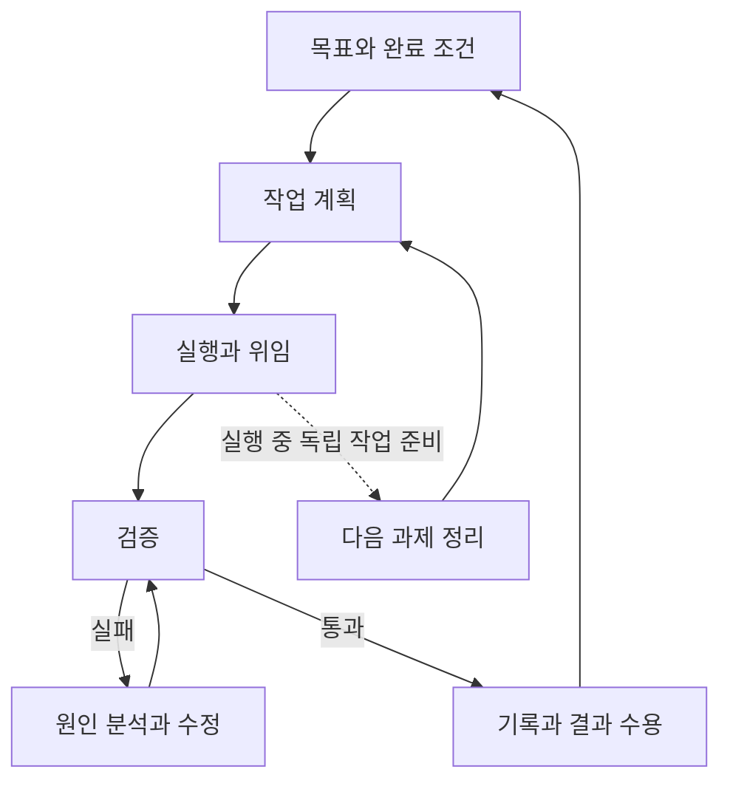

# OpenCode 팀 활용 가이드

부제: **AI에게 질문하는 단계에서, 일을 맡기고 검증하는 단계로**

OpenCode 실행, 에이전트에게 작업 맡기기, 내 컴퓨터에서 서비스 만들기 순서로 따라갑니다. 브라우저에서 먼저 모의 터미널을 써 보고, 내려받은 할 일 앱으로 실습합니다.

기존 자료 확인일: 2026-10-01. 스킬 추천·검증 운영 안내 추가: 2026-10-13. 사내 설치 링크·지원 버전·인증·모델 정보는 담당 부서의 최신 안내를 따릅니다.

---

## 01. 왜 사내 OpenCode를 사용하는가 {#why}

### 발표 요약

- 사내 업무 데이터는 승인된 사내 서비스와 모델에서 처리한다.
- 개인 토큰 잔량보다 작업 품질과 완료 조건에 집중한다.
- 작은 읽기 요청으로 시작하고 변경 내역과 테스트 결과를 확인한다.

### 본문

사내 OpenCode를 활용하면 프로젝트의 코드와 문서를 살펴보고, 구현과 테스트까지 한 흐름으로 진행할 수 있습니다. 익숙한 개발 환경에서 AI에게 작업을 맡기고 결과를 직접 확인하는 것이 장점입니다. 업무에 사용할 모델과 플러그인, MCP는 사내에서 제공하는 구성을 사용하고, 연결과 로그 저장 설정은 사내 안내를 따릅니다.

사내 AI를 활용하면 개인 토큰 잔량에 대한 부담을 줄이고 작업의 품질과 완성도에 집중할 수 있습니다. 필요한 분석과 검증을 충분히 진행하되, 사내 서비스의 사용 한도와 혼잡 상황을 고려해 작업을 나눕니다.

### 설치와 초기 설정

1. **담당 부서가 안내한 사내 OpenCode 설치 링크**를 엽니다. 안내에 따라 지원 버전, 인증, 사내 모델 연결을 설정합니다.
2. 하네스와 스킬도 사내 정책에 따라 **사내에서 배포·제공하는 구성만** 사용합니다. 개인이 만든 것과 외부에서 받은 것은 업무에 설치하거나 연결하지 않습니다.
3. 설치 링크가 보이지 않거나 필요한 구성의 제공 여부가 불분명하면 사내 담당자에게 확인합니다.

---

## 02. OpenCode는 무엇인가 {#basics}

### 발표 요약

- OpenCode는 모델을 연결해 개발 작업을 수행하는 AI 코딩 에이전트다.
- 채팅뿐 아니라 파일 읽기·수정·명령 실행·작업 위임이 가능하다.
- 사내 설치 링크로 설정을 마친 뒤, 읽기·계획부터 시작하고 작은 변경으로 검증한다.

### 본문

OpenCode는 프로젝트 안에서 AI 모델과 도구를 함께 사용하는 개발 환경입니다. 모델이 답을 생성하고, OpenCode가 파일·터미널·권한·세션을 연결합니다. 모델은 두뇌, OpenCode는 작업 공간으로 생각하면 이해하기 쉽습니다. 이 가이드에서는 터미널 화면(TUI)을 중심으로 설명합니다. 사용할 수 있는 화면과 기능은 사내 설치 버전에 따라 다릅니다.

Oh My OpenCode는 기본 OpenCode와 별개의 확장입니다. 스킬은 반복 가능한 작업 절차이고, MCP는 외부 도구나 데이터와 연결하는 인터페이스입니다. 각각 확장 기능, 작업 절차, 도구 연결이라는 역할을 맡습니다.

### OpenCode 터미널 화면 읽기

| 위치 | 확인할 내용 |
|---|---|
| 오른쪽 패널 · 현재 경로 | 세션 정보와 OpenCode를 실행한 프로젝트 폴더 |
| 왼쪽 · 작업 및 결과 | 내가 보낸 요청, 도구 실행 기록, 응답 |
| 하단 · 입력 | 질문을 적고 Enter로 제출. Ctrl+P로 명령 팔레트 열기 |
| 상태 줄 | 선택한 에이전트·모델, 실행 중인지 입력을 기다리는지 표시 |

실제 표시 위치와 이름은 설치 버전과 설정에 따라 달라질 수 있습니다.

### 모의 화면에서 먼저 연습하기

1. 이 장의 **TUI 펼치기**를 누릅니다.
2. 입력칸에 “이 앱은 어떻게 실행하나요?”라고 적고 Enter를 누릅니다.
3. 요청과 예시 결과가 기록에 추가되는지 확인합니다.
4. 입력칸에 커서가 있을 때 Ctrl+P를 누르고 ‘모델’을 검색합니다. 방향키와 Enter로 선택하고 Esc로 닫아 보세요.
5. 같은 순서를 사내 OpenCode 화면에서 따라 합니다. 모의 화면에서는 가상 경로와 예시 응답이 표시됩니다.

### 처음 실행하는 순서

1. **작업 폴더 확인.** 터미널에서 교육용 또는 승인된 프로젝트 폴더를 엽니다. 현재 경로가 맞는지 확인한 뒤 사내 설치 안내에 따라 OpenCode를 실행합니다.
2. **모델과 권한 확인.** 사내 제공 모델이 선택됐는지 확인합니다. 아직 익숙하지 않다면 설치판의 읽기·계획용 모드부터 사용합니다. 모드 이름과 실제로 허용되는 도구는 사내 설정에서 확인합니다.
3. **변경 없이 질문.** 아래 첫 작업 예시처럼 실행 방법과 테스트 위치만 읽어 달라고 요청합니다. 필요한 파일만 지정하고, 토큰·비밀번호·개인정보는 입력하지 않습니다.
4. **작은 변경 실행.** 계획, 수정 범위, 실행할 명령을 검토한 뒤 구현을 맡깁니다. 도구 승인 창이 뜨면 대상 파일·명령과 변경 범위를 확인하고 필요한 것만 허용합니다.
5. **결과 확인.** Git 프로젝트라면 `git status`와 `git diff`로 변경을 확인합니다. 해당 테스트를 실행하고, 통과·실패·미실행을 구분합니다. 다음에 이어갈 때는 기존 세션과 실제 변경 내역을 함께 확인합니다.

### 먼저 익힐 명령과 단축키

프로젝트 폴더에서 **opencode**를 실행한 뒤 **Ctrl+P**로 원하는 기능을 찾으세요.

| 입력 | 기능 | 기본 단축키 / 설명 |
|---|---|---|
| `opencode` | 현재 프로젝트에서 시작 | 프로젝트 폴더의 셸에서 입력 |
| `Ctrl+P` | 명령 팔레트 열기 | OpenCode 화면에서 기능을 검색하고 Enter로 선택 |
| `/update` | OpenCode 업데이트 | 사내 설치판에서 지원할 때 사용 |
| `/models` | 모델 확인·선택 | 사내 승인 모델을 사용 |
| `/sessions` | 이전 세션 찾기 | 목록에서 이어갈 세션 선택 |

**업데이트는 최신 사내 승인 버전 기준으로 진행하세요.** 먼저 Ctrl+P에서 업데이트를 검색합니다. 사내 안내에서 `/update`를 지원하면 안내에 따라 사용하고, 목록에 없으면 사내 설치 링크의 업데이트 절차를 따릅니다.

다른 기능이나 단축키가 필요하면 **Ctrl+P**를 열고 기능 이름으로 검색하세요. 현재 화면과 설치판에서 쓸 수 있는 항목이 표시됩니다.

### 첫 작업 예시

```text
이 프로젝트의 실행 방법과 테스트 방법을 확인해줘.
수정하지 말고 핵심 디렉터리, 진입점, 사내 규칙을 정리해줘.
확인하지 못한 것은 추측하지 말고 미확인이라고 표시해줘.
```

---

## 03. 결과를 바꾸는 스킬·하네스·메모리 {#harness}

### 발표 요약

- 같은 모델도 주어진 절차와 검증 환경에 따라 결과가 달라진다.
- 하네스와 스킬은 사내에서 제공하는 구성만 사용한다. 개인 제작본과 외부 배포본은 설치하거나 연결하지 않는다.
- 스킬은 작업 절차, 하네스는 실행·검증·재개를 관리하며, 반복 실수는 기록과 회귀 검증으로 줄인다.

### 본문

OpenCode의 결과는 모델 능력만으로 결정되지 않습니다. 요구사항, 필요한 맥락, 도구, 스킬, 검증 방식이 함께 작동해야 합니다. ‘좋은 모델이면 알아서 한다’보다 **좋은 작업 환경을 만들어 준다**는 관점이 유용합니다.

| 요소 | 역할 | 교육용 예 |
|---|---|---|
| 모델 | 문제를 해석하고 판단 | 구현 방안 제안 |
| 스킬 | 특정 업무에 반복해서 쓰는 절차 | 할 일 목록을 바꾼 뒤 버튼과 표시 결과 확인 |
| 하네스 | 실행·권한·검증·재개를 연결 | 테스트 실행, 실패 시 수정, 결과 기록 |
| 메모리 | 다음 작업에 필요한 규칙과 경험 보존 | 필터를 바꿀 때 목록이 틀어졌던 원인과 확인 방법 기록 |

OpenCode 스킬은 `SKILL.md`로 정의하고 필요할 때 로드하는 방식입니다. 장기 작업에서는 진행 기록을 남기고 실제 사용자 흐름을 검증합니다.

### 개발에 추천하는 스킬과 하네스 — 사내 제공 버전 기준

아래 표는 각 도구의 용도를 설명합니다. **업무에는 사내에서 배포·제공하는 하네스와 스킬만 사용하세요.** 직접 만든 설정이나 외부 저장소에서 받은 도구를 설치·등록·연결하지 않습니다. 사내 제공 목록에 필요한 항목이 없으면 담당 부서에 도입 검토를 요청합니다.

| 필요할 때 | 추천 후보 | 어떻게 활용할까 | 지켜야 할 기준 |
|---|---|---|---|
| 매번 같은 개발 규칙을 설명할 때 | 사내 공통 SKILL.md + AGENTS.md | 프로젝트 구조, 테스트 명령, 리뷰 기준과 반복 오류를 연결하는 기본 구성 | 팀 규칙과 실제 코드에 맞게 유지 |
| 과한 추상화·불필요한 의존성이 늘어날 때 | Ponytail | 기존 코드와 플랫폼 기능을 먼저 살펴보고 요구사항을 만족하는 작은 변경을 선택 | 검증·오류 처리·접근성까지 줄이지 않기 |
| 중간 보고와 답변이 지나치게 길 때 | Caveman | 기술적 사실은 유지하면서 반복 설명과 군더더기를 줄이기 | 조건·부정문·숫자·명령어 보존, 중요한 안내는 충분히 설명 |
| 테스트와 디버깅 절차를 일정하게 만들 때 | Superpowers의 테스트·디버깅·완료 전 검증 스킬 | 테스트 주도 개발, 원인 조사, 완료 증거 확인 등 필요한 절차를 골라 적용 | 작은 수정에 전체 절차를 과하게 적용하지 않고 사내 규칙과 충돌 여부 확인 |
| 여러 작업의 계획·위임·재개를 관리할 때 | 사내 제공 OpenCode + OmO 하네스 구성 | 작업 범위와 검증 조건을 나누고 진행 기록을 남기기 | 사내 설치판의 명령·권한·모델 연결을 먼저 확인 |

Ponytail은 구현을 단순하게 만드는 데, Caveman은 응답을 간결하게 만드는 데 초점을 둡니다. 작업지시서를 요약하는 일은 별도로 요청하는 편이 좋습니다. 지시문을 다듬거나 줄일 때는 3장 ‘프롬프트 설계’의 사내 AI 템플릿을 사용하고, 완료 조건이 빠지지 않았는지 확인합니다. 효과는 우리 팀의 실제 과제로 비교해 확인합니다.

스킬과 도구를 사용할 때는 업무 맥락, 코드, 로그 등이 연결된 서비스로 전달될 수 있습니다. **사내 제공 구성을 사용하고, 어떤 정보가 어디로 전달되는지 확인하세요.** 연결 대상과 전송 범위가 불분명하면 담당자의 안내를 받습니다.

처음에는 사내 공통 규칙과 검증 절차를 갖추고, 필요한 경우 구현 단순화나 응답 간결화 스킬을 하나씩 더하는 구성을 추천합니다. 여러 스킬을 동시에 켜기보다 작은 과제로 결과와 재작업을 비교하세요.

### 먼저 구분할 세 가지

- **에이전트**는 파일을 읽고 요청에 맞게 작업할 수 있는 AI입니다. 화면을 고치는 등 사용자가 승인한 범위에서 일을 맡깁니다.
- **스킬**은 팀이 정한 작업 절차입니다. 예를 들어 버튼을 수정한 뒤 두 화면 상태를 확인하는 순서를 알려 줍니다.
- **하네스**는 작업이 실행되는 환경입니다. 어떤 파일을 읽을 수 있는지, 어떤 명령을 실행할 수 있는지, 테스트 결과를 어떻게 받는지를 연결합니다.

처음에는 아래 예제에서 ‘완료 조건’을 읽고 직접 확인해 보세요. 확장과 여러 에이전트는 한 번의 작은 작업 흐름을 익힌 다음 살펴봐도 됩니다.

### 같은 과제를 다르게 맡기는 예제

과제: 할 일 목록에 **미완료만 보기** 버튼을 추가합니다. 예를 들어 ‘책 읽기’가 미완료이고 ‘물 마시기’가 완료라면, 버튼을 눌렀을 때 ‘책 읽기’만 보여야 합니다.

**A — 결과만 요구**

```text
할 일 목록에 필터를 추가해줘.
```

**B — 절차·검증·기록까지 요구**

```text
할 일 목록에 ‘미완료만 보기’ 버튼을 추가해줘.
먼저 현재 목록과 테스트를 살펴보고 어느 부분을 바꿀지 알려줘.

완료 조건:
- 처음에는 완료·미완료 항목이 모두 보인다.
- ‘미완료만 보기’를 누르면 미완료 항목만 남는다.
- ‘전체 보기’를 누르면 모든 항목이 다시 보인다.

검증:
- 완료 항목 ‘물 마시기’와 미완료 항목 ‘책 읽기’로 확인해줘.
- 어떤 동작을 테스트했고 결과가 어땠는지 알려줘.
```

두 예제는 작업 지시를 어떻게 구체화할 수 있는지 보여줍니다. 실습에서는 같은 모델과 초기 코드를 사용하고, 누락된 기능·테스트 결과·재작업 횟수·소요 시간을 비교해 보세요.

### 같은 실수를 줄이는 기록 방법

```text
AGENTS.md                  팀 공통 규칙과 시작 시 읽을 문서
docs/ai/known-pitfalls.md   검증된 반복 오류와 회피 방법
docs/ai/decisions.md        설계 결정과 이유
docs/ai/progress.md         현재 상태, 미완료, 다음 행동
tests/                     재발 여부를 확인할 검증
```

`docs/ai/*`는 **이 자료에서 제안한 팀 규약**입니다. 다음 작업에서도 참고할 수 있도록 AGENTS.md나 작업 지시에 읽어야 할 기록을 명시합니다. OpenCode는 프로젝트 규칙을 AGENTS.md로 제공할 수 있습니다.

좋은 오류 기록에는 ‘증상 → 원인 → 적용 조건 → 해결 → 재발 검증’이 들어갑니다. 임시 추측과 비밀번호를 영구 규칙에 넣지 않고, 오래된 내용을 정리합니다.

### 이것이 루프 엔지니어링인가?

메모리 파일 작성 자체는 주로 맥락·메모리 관리입니다. **실행 → 검증 → 오류 기록 → 절차 수정 → 재실행**까지 연결하면 반복 개선 루프를 설계하는 것으로 설명할 수 있습니다. ‘루프 엔지니어링’은 여기서 교육적 표현이며 OpenCode의 표준 기능명은 아닙니다.

반복에는 종료 조건도 필요합니다. 예를 들어 같은 오류가 두 차례 반복되면 사람에게 원인과 로그를 넘기고, 검증 도구를 실행할 수 없으면 완료로 표시하지 않습니다.

---

## 04. Oh My OpenCode와 ultrawork {#omo}

### 발표 요약

- 확장은 탐색·분해·위임·검증 흐름을 구성하는 데 도움을 준다.
- ultrawork는 작업 방식이며, 별도의 초고성능 모델을 만드는 기능은 아니다.
- 간단한 수정은 직접, 복잡한 작업은 구조화해서 맡긴다.

### 본문

Oh My OpenCode는 OpenCode에 계획·위임·검증 흐름을 더하는 확장 프로젝트입니다. 원본 저장소는 확인 시점 Oh My OpenAgent로 연결됩니다. 사내에서 계속 Oh My OpenCode라는 이름을 사용하더라도 설치된 버전의 명령과 문서를 기준으로 해야 합니다.

`ultrawork` 또는 `ulw`는 작업을 적극적으로 탐색·분해·위임·검증하도록 유도하는 방식입니다. ‘Ultra Worker를 만든다’는 표현은 이런 작업 흐름을 구성한다는 의미로 설명합니다. `Ultraworker`라는 고정 에이전트가 모든 버전에 존재하는 것은 아닙니다.

### 기대하는 이점과 적용 판단

- 관련 코드를 찾고 작업을 나누는 부담을 줄일 수 있습니다.
- 독립 작업을 위임하고 각 작업에 필요한 스킬을 연결할 수 있습니다.
- 완료 조건과 증거를 중심으로 결과를 검토하는 흐름을 만들 수 있습니다.

| 상황 | 제안 |
|---|---|
| 오타 수정·단일 설정 변경 | 기본 에이전트로 직접 처리 |
| 여러 파일에 걸친 기능 구현 | 계획을 문서화한 후 실행 |
| 작업 분해와 탐색이 많이 필요 | 설치판의 ultrawork 흐름 검토 |
| 같은 파일을 여러 작업이 수정 | 병렬화보다 책임 분리·통합 순서 우선 |
| 사내 서비스 혼잡 | 동시 실행 수를 줄이고 작업 준비 |

작업 규모에 맞춰 활용 방식을 선택하세요. 여러 에이전트에게 나누어 맡길 때는 맥락을 전달하고 결과를 합치는 시간도 고려해야 합니다.

교육용 지시:

```text
ulw
이 작업의 목표는 사용자 목록 필터 기능 구현이다.
기존 구조를 확인하고 범위를 나눈 뒤 적절한 스킬과 검증 방법을 적용해줘.
완료 조건과 실제 검증 결과를 보고해줘.
사내에서 승인된 모델과 도구만 사용해줘.
```

---

## 05. 프롬프트를 먼저 설계한다 {#prompts}

### 발표 요약

- 프롬프트를 다듬거나 작업지시서를 짧게 만들 때는 사내 AI를 활용한다.
- 목표·범위·제약·완료 조건·검증 방법을 빠뜨리지 않는다.
- 짧게 줄여도 제약과 검증 기준은 유지하고, 업무 자료는 항상 사내 제공 AI에서 처리한다.

### 본문

머릿속 아이디어를 바로 긴 작업으로 맡기면 실행 중에 조건이 계속 달라질 수 있습니다. **프롬프트의 표현을 다듬거나 긴 작업지시서를 짧게 정리할 때는 사내에서 제공하는 AI를 활용하는 것이 좋습니다.** 요구사항 정리에 사내 AI를 활용한 뒤 OpenCode에 전달하면 목표와 판단 기준을 더 명확하게 만들 수 있습니다. 정리한 지시문은 직접 읽어보고 의도와 빠진 조건이 없는지 확인합니다.

짧은 문장에도 사내 시스템명, 코드 경로, 오류 로그, 고객 정보가 포함될 수 있습니다. 단순 문장 다듬기라도 데이터 전송이 발생할 수 있으므로 업무 지시와 자료는 항상 사내에서 제공하는 AI에서 처리합니다. 축약한 지시문은 원문과 비교해 범위, 제외 사항, 제약, 완료 조건, 검증 방법이 보존됐는지 확인합니다.

### 1단계 — 사내 AI에게 업무 지시를 정리시키기

```text
다음 요구를 코딩 에이전트에 전달할 작업 지시로 정리해줘.
목표, 범위, 제외 범위, 제약, 완료 조건, 검증 방법, 산출물 순서로 작성해줘.
확인되지 않은 환경은 만들어내지 말고 확인 필요로 표시해줘.
구현 방법을 과하게 고정하지 말고, 기존 프로젝트 구조를 먼저 확인하도록 해줘.

요구: 할 일 목록에서 완료한 항목을 잠시 숨겼다가 다시 볼 수 있게 하고 싶다.
```

### 긴 작업지시서를 짧게 만드는 템플릿

사내 AI에서 사용하는 교육용 지시입니다. 실제로 사용할 수 있는 모델과 입력 범위는 사내 안내를 따릅니다.

```text
아래 작업지시서를 코딩 에이전트에 전달하기 쉽게 짧게 정리해줘.
중복 설명은 줄이되 목표, 범위, 제외 범위, 제약, 완료 조건, 검증 방법은 유지해줘.
부정 조건, 수치, 파일 경로, API 이름을 임의로 바꾸지 말아줘.
조건을 빠뜨려야만 길이를 맞출 수 있다면 길이보다 의미 보존을 우선해줘.
확인할 사항은 별도로 표시하고, 새 요구사항은 추가하지 말아줘.
마지막에 원문 대비 빠지거나 달라진 조건이 있는지 점검해줘.

원문: [사내에서 허용된 작업지시서]
```

### 2단계 — 실행할 프롬프트

```text
목표: ‘미완료만 보기’와 ‘전체 보기’로 할 일 목록을 전환한다.
범위: 버튼 두 개와 목록에 표시할 항목.
제외: 인증 변경, 전체 UI 개편, 관련 없는 리팩터링.
제약: 기존 구조와 팀 규칙을 따른다. 승인된 도구만 사용한다.
완료 조건: 미완료 보기에서 완료 항목이 숨겨지고, 전체 보기에서 다시 표시된다.
검증: 미완료 1개와 완료 1개로 두 버튼을 눌러 보고 결과를 확인한다.
산출물: 변경 요약, 실제 검증 결과, 남은 문제, 재개 기록.

먼저 관련 코드를 확인하고 계획을 제시해줘. 계획 확인 후 구현한다.
```

좋은 프롬프트에는 무엇을 해야 하고 어떤 상태를 완료로 볼지 분명하게 드러납니다. 필요한 맥락을 유지하면서 중복 문장을 줄입니다.

---

## 06. 계획·실행 역할과 세션 관리 {#sessions}

### 발표 요약

- Planner는 무엇을 할지, Executor는 계획을 어떻게 진행할지 담당한다.
- 계획 파일과 대화 세션은 서로 다른 기록이다.
- 끊겼을 때는 현재 코드와 검증 기록을 확인한 뒤 재개한다.

### 역할 이해

| 역할 | 하는 일 | 주요 산출물 |
|---|---|---|
| Planner | 요구 분석, 범위·의존성·완료 조건 정리 | 작업 계획 |
| Plan Executor / Orchestrator | 계획 순서 관리, 위임, 결과 통합 | 진행 상태와 통합 결과 |
| Worker | 특정 구현·탐색·테스트 수행 | 변경 내용과 근거 |
| Reviewer / QA | 결과와 완료 조건을 독립적으로 확인 | 발견 사항과 검증 증거 |
| 사람 | 우선순위·제약·수용 여부 판단 | 승인된 목표와 다음 작업 |

이 표는 작업을 나누는 기준입니다. 하나의 에이전트가 여러 역할을 맡을 수도 있습니다. OpenCode의 기본 Plan·Build와 확장 플러그인이 제공하는 역할은 구분해서 확인하세요.

### 설치 버전에 따른 차이

| 구분 | 기존 OmO 자료에서 알려진 방식 | 현재 원본 dev 문서에서 확인한 방식 |
|---|---|---|
| 계획·실행 | Prometheus / Atlas | 메인 에이전트의 계획·실행 흐름 |
| 명령 예 | 계획 후 `/start-work` | `/ulw-plan` 후 `/ulw-execute` |
| 계획 경로 | `.sisyphus/plans/*.md` | `.omo/plans/*.md` |
| 진행 상태 경로 | `.sisyphus/boulder.json` | `.omo/boulder.json` |

왼쪽은 이전 방식, 오른쪽은 참고자료 확인일의 개발 브랜치(dev) 문서를 정리한 것입니다. 사내 버전에 따라 이름·명령·저장 경로가 다를 수 있으므로 실습에는 설치된 버전의 안내를 사용하세요.

### 계획은 무엇을 저장하는가

계획 파일에는 작업 항목, 참조 파일, 완료 조건, 검증 방법을 남깁니다. 진행 상태는 어떤 계획을 실행 중인지 연결하고, 대화 세션은 요청과 응답을 보존합니다. **계획 파일만으로 이전 대화의 모든 맥락이 복원되지는 않습니다.**

계획을 다음 세션에서도 쓰려면 저장할 파일 경로를 작업 지시에 명시하세요. 플러그인을 쓰지 않는 팀은 계획을 `docs/ai/plans/<작업명>.md`에 저장하도록 명시할 수 있습니다. 이 경로는 팀 제안이며 OpenCode 기본 저장 경로가 아닙니다.

### 재개할 때의 순서

1. `/sessions`에서 해당 대화를 찾거나 작업 계획을 명시해 새 세션을 시작합니다.
2. 해당 설치판의 계획·진행 기록과 실제 변경 내용을 읽습니다.
3. 마지막 테스트 결과를 확인하고 필요한 검증을 다시 실행합니다.
4. 완료된 항목과 남은 항목을 맞춘 뒤 다음 작업을 진행합니다.

진행 파일을 지워서 재개 문제를 해결하려고 하기 전에 백업과 원인을 확인합니다. 새 세션 시작과 진행 상태 삭제는 다른 행동입니다.

복사할 재개 지시:

```text
이 작업의 계획 파일과 진행 기록을 읽고 재개해줘.
먼저 실제 코드 변경과 마지막 검증 결과가 기록과 일치하는지 확인해줘.
완료/미완료/막힌 항목을 정리한 뒤 다음 미완료 항목을 수행해줘.
이전 대화에만 있고 파일에 없는 내용은 추측하지 말아줘.
```

---

## 07. 개인도 에이전트 팀을 구성할 수 있다 {#team}

### 발표 요약

- 탐색·구현·검증을 서로 다른 역할로 나눌 수 있다.
- 독립 작업은 병렬화하고, 의존 작업은 순서를 지킨다.
- 동일 파일 수정과 결과 통합은 명확히 관리한다.

### 본문

OpenCode에서는 주 에이전트와 하위 에이전트의 역할을 나눌 수 있습니다. 업무에서는 사내 제공 구성 안에서 ‘탐색·구현·검증’ 역할을 선택합니다. 위임 방법과 권한 범위는 사내 설치판의 안내를 확인합니다.

에이전트마다 **맡길 작업의 범위와 결과를 받을 형식**을 정해 두면 역할을 나누고 결과를 합치기 쉽습니다.

교육용 팀 구성:

| 담당 | 입력 | 맡기는 범위 | 결과 |
|---|---|---|---|
| 조정자 | 목표와 완료 조건 | 분해·순서·통합 | 진행표 |
| 탐색 담당 | 관련 기능 질문 | 읽기와 위치 확인 | 관련 파일과 위험 |
| 구현 담당 | 명확한 변경 범위 | 제품 코드 수정 | 변경 요약 |
| 테스트 담당 | 완료 조건 | 합의된 테스트 파일 | 실행 결과 |
| 리뷰 담당 | 변경 내역 | 읽기와 검토 | 문제와 근거 |

### 병렬로 진행할 수 있는 것

목록 필터 로직과 독립된 도움말 문구는 병렬로 작업할 수 있습니다. 반면 공통 데이터 구조를 바꾸는 작업과 이를 사용하는 기능 구현은 데이터 형식을 먼저 정해야 합니다.

교육용 지시:

```text
작업을 구현·검증·문서화로 나누어줘.
독립 작업만 병렬로 수행하고 동일 파일 수정은 겹치지 않게 해줘.
각 작업의 입력, 수정 가능 범위, 완료 조건, 결과 형식을 먼저 정리해줘.
마지막에는 변경 내용을 통합하고 전체 검증을 실행해줘.
```

필요하다면 worktree로 작업 공간을 분리하지만 통합 책임은 남습니다. 처음에는 작은 수의 역할로 시작하고, 공유 모델 서버의 혼잡과 위임 비용을 보면서 늘립니다.

---

## 08. 일이 도는 동안 다음 일을 설계한다 {#workflow}

### 발표 요약

- 혼잡 시간에는 검증을 진행하고, 다음 작업의 개선 사항을 정리한다.
- 사내 SonarQube·API 테스트·취약점 분석·Playwright E2E로 현재 결과를 확인한다.
- 재현 조건과 증거를 남기고 우선순위·완료 조건·재검증 방법을 다음 계획에 반영한다.

### 본문

업무는 ‘계획 → 일 시키기 → 기다리기’에서 끝나지 않습니다. 한 작업이 진행되는 동안 사람은 다음 과제의 조건과 검증 방법을 준비할 수 있습니다. 단, 진행 중인 코드와 같은 파일을 동시에 바꾸거나, 아직 확정되지 않은 결과에 의존해 다음 구현을 시작하지 않습니다.



### 실무 예

작업 A의 목록 필터 구현이 실행 중일 때, 작업 B의 엑셀 출력 항목과 가상 샘플을 정리합니다. A 결과가 도착하면 테스트와 변경 내용을 검토하고, 확정된 데이터 구조를 B 계획에 반영합니다.

| 시점 | 사람의 일 | 에이전트의 일 |
|---|---|---|
| 시작 전 | 목표·제약·완료 조건 정리 | 구조 탐색·계획 |
| 실행 중 | 독립된 다음 과제 준비 | 구현·중간 검증 |
| 결과 도착 | 증거 확인·수용 판단 | 실패 수정·결과 정리 |
| 완료 후 | 다음 우선순위 확정 | 진행·오류 기록 갱신 |

### 혼잡 시간을 검증과 개선에 활용하기

**사용자가 몰리는 시간대에는 SonarQube, API 테스트, 취약점 분석, E2E 테스트를 진행하고 다음 작업들에서 개선할 사항을 도출하는 것을 추천합니다.** AI 응답이 지연되는 동안에는 사내에서 제공하는 검증 도구로 이미 만들어진 결과를 확인합니다.

| 검증 활동 | 확인할 내용 | 다음 작업에 남길 개선 사항 |
|---|---|---|
| 사내 SonarQube | 정적 분석에서 발견한 품질·보안 문제를 실제 코드와 대조 | 우선 수정할 문제, 영향 범위, 사내 품질 기준 |
| API 테스트 | 정상·오류 응답, 권한별 접근, 입력 경계값, 응답 데이터 | 실패를 재현할 요청과 기대 결과, 보완할 테스트 |
| 취약점 분석 | 사내 승인 도구가 지원하는 의존성·설정·시크릿 검사 | 영향받는 구성요소, 수정 후보, 예외 판단과 재검증 조건 |
| E2E / Playwright | 실제 사용자의 클릭·입력·화면 이동·오류 처리 흐름 | 재현 절차, 실패 로그·trace, 추가할 회귀 테스트 |

E2E는 사용자의 전체 흐름을 확인하는 테스트 방식이고, Playwright는 이를 구현하는 도구입니다. Playwright로 API 요청과 응답을 검사할 수도 있습니다. 화면에서 확인할 동작과 API에서 확인할 응답을 나누어 테스트를 구성하세요.

테스트 완료에서 멈추지 말고 **발견 → 재현 → 원인 후보·영향 정리 → 우선순위 결정 → 다음 작업의 완료 조건 작성 → 재검증**으로 연결합니다. 예를 들어 권한 없는 사용자의 요청이 성공했다면 요청·응답을 증거로 남기고, 접근 차단 수정과 회귀 테스트를 다음 계획에 함께 넣습니다.

**모든 분석·테스트는 항상 사내에서 제공하는 도구와 승인된 대상에서 수행합니다.** SonarQube 분석 자료, API 요청·응답, 브라우저 trace와 캡처에는 코드나 업무 데이터가 포함될 수 있습니다. 사내 서버·저장소를 사용하고 외부 분석 서비스로 보내지 않습니다. 공유 테스트 서버도 혼잡하면 동시 실행 수를 줄이고 로컬 분석이나 기존 결과 검토부터 진행합니다.

사내 AI가 필요한 추가 분석은 혼잡 상태에 맞춰 예약하거나 뒤로 미루고, 우선 모델 호출 없이 실행 가능한 테스트를 진행합니다. 실행 도중인 변경 사항과 섞이지 않도록 테스트할 코드 버전과 데이터를 고정합니다. 실행하지 못한 검사는 이유와 함께 다음 확인 항목으로 남깁니다.

### 다음 작업으로 넘길 개선 기록

```text
검증 대상: 코드 버전 / 사내 테스트 환경 / 데이터
실행한 도구와 검사 범위:
발견한 문제와 재현 절차:
증거 위치: 사내 로그 / 리포트 / trace
영향과 우선순위:
다음 작업에서 바꿀 내용:
완료 조건과 재검증 방법:
미실행 검사와 남은 불확실성:
```

야간 자동 실행을 계획한다면 실행 시간, 사용 자원, 실패 시 중단 조건과 결과 확인 담당자를 미리 정합니다.

---

## 09. 완료는 검증 결과로 판단한다 {#verification}

### 발표 요약

- 로직은 단위 테스트, API 동작은 API 테스트, 사용자 흐름은 Playwright E2E로 확인한다.
- 사내 SonarQube와 취약점 분석 도구의 결과를 검토해 다음 작업의 개선 사항으로 연결한다.
- 도구가 검사한 범위와 실행 증거를 함께 보고한다.

### 검증 방법

| 방법 | 확인하는 것 | 보고할 증거 |
|---|---|---|
| 단위 테스트 | 함수·변환·경계값 | 실행 명령과 통과/실패 |
| API 테스트 | 상태 코드·응답·입력 검증·권한별 접근 | 재현 요청, 기대 응답과 실제 결과 |
| 사내 SonarQube | 코드 정적 분석 결과와 품질·보안 검토 | 분석 범위, 발견 항목, 검토·수정 우선순위 |
| Playwright | 클릭·입력·화면·전체 흐름 | 기대 결과 검증, 실행 기록(trace), 필요한 화면 캡처 |
| 타입 검사·빌드 | 타입 오류와 빌드 가능 여부 | 실제 실행 결과 |
| Trivy | 지원 대상의 취약점·설정·시크릿 등 | 스캐너 설정과 결과 |
| 사람의 검토 | 요구 적합성·업무 판단·시각 품질 | 수용 또는 수정 의견 |

API 테스트와 E2E는 서로 보완합니다. SonarQube는 사내 설치 버전·언어·규칙에 따라 검사 범위가 달라지므로 발견 항목을 검토하고, 실제 사용자 동작도 따로 확인합니다. SonarQube와 테스트 도구는 항상 사내에서 제공하는 구성을 사용합니다. 분석 결과와 로그의 전송·저장 위치도 확인합니다.

### Playwright 예제

```ts
import { test, expect } from '@playwright/test';

test('미완료만 보기에서 완료 항목이 숨겨진다', async ({ page }) => {
  await page.goto('/todos'); // 교육용 경로와 baseURL 설정 필요
  const unfinished = page.getByText('책 읽기', { exact: true });
  const finished = page.getByText('물 마시기', { exact: true });

  await expect(finished).toBeVisible();
  await page.getByRole('button', { name: '미완료만 보기' }).click();
  await expect(unfinished).toBeVisible();
  await expect(finished).toBeHidden();

  await page.getByRole('button', { name: '전체 보기' }).click();
  await expect(finished).toBeVisible();
});
```

- 준비 데이터: ‘책 읽기’는 미완료, ‘물 마시기’는 완료.
- 확인 순서: 전체 목록 → 미완료만 보기 → 전체 보기.
- 테스트는 버튼을 눌렀을 때 실제로 어떤 항목이 보이는지 검사합니다.

### Trivy 같은 실행 도구 연결

```sh
# 교육용 예: 설치와 DB 준비가 필요
trivy fs --scanners vuln,secret,misconfig --exit-code 1 .
```

문제가 발견되면 실패 종료 코드를 반환하는 예제입니다. 팀에서 허용할 심각도·예외·스캐너 범위는 별도로 정합니다. 검사 결과는 지정한 대상과 규칙에 대한 결과이므로 코드 리뷰와 다른 검증 결과를 함께 살펴봅니다.

Trivy는 실행 방식에 따라 DB 등 외부 자원에 접근할 수 있습니다. 사내 사용 시 내부 미러 또는 오프라인 DB를 준비하고 공식 네트워크 운용 문서를 확인합니다.

### 완료 보고 템플릿

```text
변경 내용:
실행한 검증 명령:
통과/실패/미실행 결과:
스크린샷·로그·리포트 위치:
미해결 문제와 영향:
다음 작업을 위한 기록:
```

테스트를 맡기기 전에 도구 설치, 실행 권한, 필요한 패키지와 테스트 데이터를 준비합니다.

---

## 10. 보안 엑셀 파일을 다루는 방법 {#files}

### 발표 요약

- AI가 사내에서 허용된 프로그램을 활용해 사내 자료를 읽도록 한다.
- 자료 접근과 활용은 사내에서 허용한 권한과 범위 안에서 진행한다.
- 필요한 내용을 정리하고 원본과 비교해 결과를 확인한다.

### 본문

보안 엑셀 파일도 사내에서 허용된 프로그램을 AI가 활용할 수 있도록 연결하면 업무에 필요한 내용을 읽고 정리하는 데 활용할 수 있습니다. 핵심은 **사내에서 사용이 허용된 프로그램과 기능을 통해, 허용된 범위 안에서 사내 자료를 읽게 하는 것**입니다.

예를 들어 담당자가 접근할 수 있는 엑셀 파일을 허용된 프로그램으로 열고, AI가 필요한 시트와 항목을 읽어 목록을 정리하거나 값을 비교하도록 작업을 구성할 수 있습니다. 사용할 프로그램과 연결 방식, 읽을 수 있는 자료의 범위는 사내 환경과 권한에 맞춰 정합니다. 모델과 연결 도구도 사내에서 제공하는 구성을 사용합니다.

작업을 맡길 때는 대상 파일, 필요한 시트와 열, 정리할 내용, 결과 형식을 구체적으로 알려줍니다. 문서보안이 적용된 자료는 사내에서 허용한 열람·처리 절차를 따르고, 읽은 내용의 활용과 저장도 허용된 범위 안에서 진행합니다.

### 작업 순서

1. 사용할 프로그램과 AI 연결 방식이 사내에서 허용되는지 확인합니다.
2. 접근 가능한 자료 중 작업에 필요한 파일·시트·열을 지정합니다.
3. AI가 해당 프로그램을 활용해 자료를 읽고 필요한 내용을 정리하도록 합니다.
4. 정리한 결과를 원본의 행 수·항목·수치와 비교해 확인합니다.
5. 파일을 수정하는 작업은 사본에서 진행하고, 수식과 서식도 함께 확인합니다.

### 작업 지시 예시

```text
사내에서 허용된 프로그램과 연결 방식을 사용해 지정한 엑셀 자료를 읽어줘.
대상 파일과 시트: [파일명 / 시트명]
읽을 항목: [필요한 열과 범위]
정리할 내용: [비교·요약할 내용]
결과 형식: [표 / 요약 / 결과 파일]

허용된 접근 권한과 자료 활용 범위 안에서 진행해줘.
원본은 수정하지 말고, 정리한 값이 원본과 일치하는지 확인해줘.
읽지 못한 항목이나 추가 권한이 필요한 부분은 따로 알려줘.
```

---

## 11. 결론 — 좋은 스킬과 하네스를 함께 사용하자 {#conclusion}

### 발표 요약

- 사내 설치 링크를 따라 구성하고, 사내에서 제공하는 스킬과 하네스만 사용한다.
- 불필요한 문맥은 줄이고 필요한 분석·검증은 유지한다.
- 재작업을 줄이고 검증된 결과를 남기는 것을 목표로 한다.

### 본문

OpenCode를 잘 쓰는 핵심은 일을 명확하게 정의하고, 적절한 스킬과 실행 환경을 연결하며, 결과를 검증하는 것입니다. 팀이 만든 공통 규칙과 검증 절차를 사용하면 매번 같은 지시를 다시 만드는 부담을 줄일 수 있습니다.

이미 잘 만들어진 스킬과 하네스는 사내에서 제공하는 버전으로 활용합니다. 항상 사내 제공 구성을 사용하고, 우리 프로젝트·설치 버전·사내 정책에 맞는지와 연결된 도구의 데이터 전송 범위를 확인합니다. 제공되지 않은 도구는 담당자에게 검토를 요청합니다.

**‘토큰을 아껴 써’라는 지시만으로 작업 품질이 좋아지지는 않습니다.** 필요한 탐색·분석·검증까지 줄이면 품질이 떨어지고 재작업이 늘 수 있습니다. 중복 로그와 불필요한 맥락은 줄이되, 완료 조건을 확인하는 데 필요한 작업은 유지합니다.

토큰 사용량은 중복 설명과 불필요한 로그부터 줄이고, 결과를 확인하는 데 필요한 분석과 테스트는 충분히 진행하세요.

### 내일부터 해볼 작은 실습

- [ ] 담당 부서의 사내 설치 링크와 승인된 모델·설치 버전을 확인한다.
- [ ] 하네스와 스킬이 사내 제공 목록에 있는지 확인한다.
- [ ] 작은 기능 하나의 목표와 완료 조건을 작성한다.
- [ ] 관련 규칙과 스킬을 읽고 계획을 만든다.
- [ ] 일을 맡기고 실행 중에는 독립된 다음 과제를 준비한다.
- [ ] 실제 테스트 결과를 보고 완료를 판단한다.
- [ ] 오류와 다음 행동을 기록하고 다음 세션에서 읽는다.

### 마지막 화면 문구

**AI에게 질문만 하지 말고, 일을 설계하고 맡기고 검증하세요.**

**좋은 스킬과 하네스는 팀의 경험을 다음 작업에 연결합니다.**

---

## 12. 처음 켜 보는 웹 서비스 {#service-start}

### 발표 요약

- 할 일 앱의 Python 또는 Node.js ZIP을 내려받아 압축을 풉니다.
- PowerShell에서 install.ps1, start.ps1을 차례로 실행합니다.
- 브라우저에서 할 일을 추가하고 완료 표시가 저장되는지 확인합니다.

### 준비할 것

- Windows의 PowerShell과 웹 브라우저.
- **Python + FastAPI로 시작**한다면 Python 3.10 이상. 사내 환경이라면 승인된 Python과 패키지 저장소를 사용합니다.
- **Node.js로 시작**한다면 Node.js 22.13 이상. 브라우저에서 보이는 결과와 실습 순서는 같습니다. 한 가지만 선택해도 다음 장을 진행할 수 있습니다.
- OpenCode는 앱을 켠 뒤 3장 ‘첫 기능을 OpenCode에 맡기기’에서 사용합니다. 사내 PC의 OpenCode 설치·인증은 담당 부서의 안내를 따릅니다.

### 1. 다운로드하고 폴더 열기

이 장의 다운로드 버튼에서 ZIP 한 개를 받으세요. 파일을 우클릭해 **모두 압축 풀기**를 선택합니다. 압축을 푼 폴더에서 `install.ps1`이 보이는 위치로 이동하세요. 파일 탐색기 주소창에 `powershell`을 입력하고 Enter를 누르면 그 위치에서 PowerShell이 열립니다.

```powershell
Get-Location
Get-ChildItem
.\install.ps1
```

첫 두 줄은 현재 경로와 파일 목록을 보여 줍니다. 세 번째 줄의 `.\`는 현재 폴더의 파일을 실행한다는 뜻입니다. Python에서는 필요한 패키지를 프로젝트 전용 공간인 `.venv`에 설치합니다. Node.js 예제는 기본 기능을 사용하므로 스크립트에서 런타임과 SQLite 지원을 확인합니다.

### 2. 서버 켜기

```powershell
.\start.ps1
```

브라우저 주소창에 Python은 `http://127.0.0.1:8000`, Node.js는 `http://127.0.0.1:3000`을 입력하세요. `127.0.0.1`은 내 컴퓨터를 가리킵니다. 뒤의 숫자는 프로그램의 접속 번호인 **포트**입니다. 서버가 켜지는 동안 PowerShell 창은 그대로 두세요. 종료하려면 그 창에서 Ctrl+C를 누릅니다.

### 3. 저장 확인하기

1. ‘책 읽기’를 입력하고 **추가**를 누릅니다.
2. ‘물 마시기’를 추가하고 체크합니다.
3. 브라우저를 새로고침합니다. 두 항목과 완료 표시가 유지되는지 확인합니다.
4. 서버를 종료했다가 같은 폴더에서 다시 켭니다. 두 항목이 여전히 표시되면 SQLite에 저장된 것입니다.

### 어디서 막혔는지 확인하기

| 보이는 증상 | 확인할 곳 |
|---|---|
| install.ps1을 찾지 못함 | 압축을 풀었는지와 현재 경로를 확인합니다. |
| Python이나 Node.js가 없음 | 사내 설치 안내에서 지원 버전과 설치 방법을 확인합니다. 설치 후 새 PowerShell을 엽니다. |
| 스크립트 실행이 제한됨 | 승인된 실행 방법을 사내 담당자에게 확인합니다. |
| 페이지에 연결하지 못함 | PowerShell에 서버 실행 주소가 나왔는지, 주소와 포트가 같은지 확인합니다. |
| 포트가 이미 사용 중임 | `.\start.ps1 -Port 8010`으로 켜고 브라우저에서도 8010을 사용합니다. |

---

## 13. 브라우저·서버·데이터 이해하기 {#service-anatomy}

### 발표 요약

- 화면은 public 폴더에, 요청을 처리하는 코드는 서버 파일에 있습니다.
- 추가 버튼을 누르면 브라우저가 서버에 POST 요청을 보냅니다.
- 서버는 SQLite에 저장하고, 브라우저는 응답을 받아 목록을 갱신합니다.

### 파일 세 곳만 찾기

| 파일 | 하는 일 | 처음 바꿔볼 것 |
|---|---|---|
| `public/index.html` | 제목, 입력칸, 버튼의 모양과 자리 | 화면 제목 바꾸기 |
| `public/app.js` | 버튼을 누르면 서버에 요청하고 응답을 화면에 표시 | 목록에 어떤 항목을 보여줄지 바꾸기 |
| `app.py` 또는 `server.mjs` | 요청을 받아 확인하고 SQLite로 저장 | 저장 규칙 바꾸기 |

화면 제목을 ‘나의 독서 목록’으로 바꾸고 새로고침해 보세요. 입력한 데이터는 서버가 처음 실행될 때 생성하는 `tasks.db`에 남습니다.

### 추가 버튼 한 번 따라가기

```text
입력칸에 책 읽기 → 추가 버튼 → POST /api/tasks
→ 서버가 입력을 확인 → SQLite에 저장
→ 브라우저가 응답을 받아 화면에 표시
```

**API**는 브라우저와 서버가 주고받는 약속입니다. **JSON**은 그 요청이나 응답을 글자로 표현하는 형식입니다. 예를 들어 추가 요청의 본문은 `{"title":"책 읽기"}`입니다.

| 요청 | 의미 | 응답 예 |
|---|---|---|
| GET /api/tasks | 목록을 읽기 | `[]`는 빈 목록 |
| POST /api/tasks | 새 할 일 추가 | 201과 새 항목 |
| PATCH /api/tasks/1 | 1번 항목의 완료 상태 변경 | 200과 바뀐 항목 |

실행한 서버 주소 뒤에 `/api/tasks`를 붙여 브라우저에서 열어 보세요. 제목과 완료 여부가 담긴 목록이 보입니다. 새로고침할 때 화면이 목록을 불러오는 경로입니다.

---

## 14. 첫 기능을 OpenCode에 맡기기 {#service-first-change}

### 발표 요약

- 서버가 켜진 창 옆에서 새 PowerShell을 열고 프로젝트 폴더에서 OpenCode를 시작합니다.
- 미완료만 보기 기능의 목표와 실제 확인 방법을 함께 전달합니다.
- 직접 눌러 보고 test.ps1 결과와 변경 파일을 확인합니다.

### 1. 먼저 읽어 달라고 하기

서버 창은 켜 둡니다. 압축을 풀었던 프로젝트 폴더에서 **새 PowerShell 창**을 열고 `opencode`를 실행합니다. OpenCode에서 아래 요청을 보냅니다.

```text
이 프로젝트를 읽고 화면 파일, 서버 파일, 테스트 파일을 알려줘.
할 일을 추가하면 어떤 파일에서 처리하는지 순서대로 설명해줘.
지금은 파일을 변경하지 말아줘.
```

답변에 나온 파일을 직접 열어 2장 ‘브라우저·서버·데이터’의 구조와 비교합니다. 이름이 다르거나 경로가 안 보이면 OpenCode가 열린 폴더부터 확인하세요.

### 2. 버튼 하나 추가하기

```text
할 일 목록에 미완료만 보기와 전체 보기 버튼을 추가해줘.
미완료만 보기를 누르면 완료한 항목이 화면에서 숨겨져야 해.
전체 보기를 누르면 다시 모두 보여야 하고 데이터는 유지되어야 해.
먼저 바꿀 파일과 확인 방법을 알려줘. 확인한 뒤 구현을 요청할게.
```

설명에 어느 파일을 바꾸고 어떻게 확인할지가 들어 있는지 봅니다. 범위가 적절하면 ‘계획대로 진행해줘’라고 답하세요. 이 과제의 목적은 화면에 보이는 목록을 바꾸는 것입니다. 기존 데이터를 삭제하거나 저장 형식을 바꿀 필요는 없습니다.

### 3. 완료 기준대로 눌러 보기

1. 브라우저를 새로고침합니다.
2. 전체 보기에서 ‘책 읽기’와 ‘물 마시기’가 모두 보이는지 확인합니다.
3. 미완료만 보기를 누르면 아직 체크하지 않은 ‘책 읽기’만 남아야 합니다.
4. 전체 보기에서 ‘물 마시기’와 완료 표시가 다시 보이면 통과입니다.

### 4. 테스트 결과 읽기

별도 PowerShell에서 아래를 실행합니다.

```powershell
.\test.ps1
```

기본 테스트는 **조회·추가·완료 변경·저장**을 검사합니다. Python에서는 `OK`, Node.js에서는 `pass 1`을 찾으세요. 이 결과와 버튼을 직접 눌러 본 결과를 따로 기록합니다.

버튼이 보이지 않으면 새로고침하고 변경 파일이 실제 실행 중인 폴더에 있는지 확인하세요. 테스트가 실패하면 OpenCode에 실패 메시지와 발생 단계만 전달하고, 어떤 입력에서 다시 확인할지 물어봅니다.

---

## 15. 내 아이디어로 바꿔보기 {#service-your-idea}

### 발표 요약

- 누가 쓰는지, 첫 기능은 무엇인지, 무엇을 보면 완료인지 세 줄로 적습니다.
- 기존 예제에서 작은 기능 하나를 바꿔 브라우저에서 확인합니다.
- 다음 작업에 필요한 변경 내용과 검증 결과를 한 줄씩 남깁니다.

### 아이디어 세 줄

```text
누가 쓰나요? 읽을 책을 정리하려는 나.
무엇을 할 수 있어야 하나요? 책 제목을 등록하고 다 읽으면 표시한다.
어떻게 확인하나요? 두 권을 추가하고 한 권을 완료하면 미완료 목록에는 한 권만 남는다.
```

첫 기능을 정했다면 기존 예제의 제목과 입력 안내부터 바꿔 보세요. 여러 사용자, 로그인, 외부 공개 같은 기능은 첫 흐름을 완성한 다음 별도 과제로 나누면 됩니다.

### 내 작업을 시작하는 요청

```text
아래 아이디어에서 지금 구현해 볼 기능을 한 가지 골라줘.
현재 코드가 그 기능을 어느 정도 지원하는지 확인해줘.
바꿀 파일과 브라우저에서 확인할 순서를 적어줘.
내가 계획을 확인한 후 변경을 진행해줘.

사용자:
첫 기능:
화면에서 확인할 결과:
```

### 완료하고 다음 작업 남기기

- **바꾼 것** 한 줄. 예를 들어 화면을 독서 목록으로 바꿨습니다.
- **직접 확인한 것** 한 줄. 예를 들어 책 두 권을 등록하고 한 권을 완료했습니다.
- **다음에 할 것** 한 줄. 예를 들어 책 제목으로 검색할 수 있게 합니다.

서버를 끄기 전 마지막으로 테스트 결과를 확인하고 Ctrl+C로 종료하세요.

---

## 부록 A. 용어집

| 용어 | 설명 |
|---|---|
| Agent | 모델과 도구를 사용해 작업을 수행하는 주체 |
| Skill | 특정 업무에 사용할 재사용 절차·참고자료 |
| Harness | 에이전트의 실행·검증·권한·작업 재개를 관리하는 구성 |
| MCP | 도구·데이터와 연결하는 인터페이스 |
| Session | 요청·응답·도구 사용이 이어지는 대화 단위 |
| Plan | 목표를 완료하기 위한 작업·검증 목록 |
| Orchestrator | 작업 분해·위임·결과 통합을 관리하는 역할 |
| Memory | 다음 작업에 활용할 규칙·결정·경험 기록 |
| Regression test | 이전에 되던 기능이나 해결한 오류가 다시 깨지는지 확인하는 검증 |

## 부록 B. 팀 공통 작업 지시

```text
목표:
범위:
제외 범위:
현재 환경과 참조 파일:
사내 제약:
완료 조건:
실행할 검증:
결과 보고 형식:
계획·진행 기록 경로:
```
